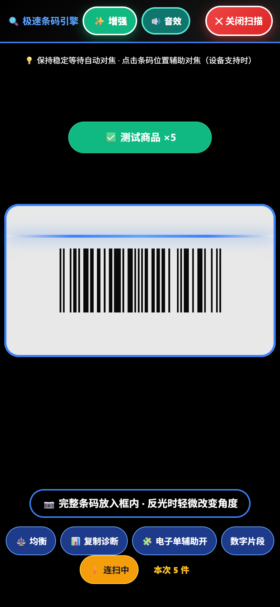

# v5.0.3 验收报告（含"扫码跳错商品"专项）

## v5.0.4 追加验收（真机诊断驱动）

| 项 | 结果 |
| --- | --- |
| 竖屏 720×1080 轨道：框=预览、`roiShare=37.5%` | PASS |
| 取消无效整幅补扫（`fullFrames=0`） | PASS |
| 主路径开 `TRY_HARDER` 后后备链不再启动（`recoveryStarts=0`） | PASS |
| 首帧遮罩在 `readyState=4` 后自动隐藏 | PASS |
| 连扫计数在竖屏下仍为 7/7 件 | PASS |
| 58 项单元/交互测试 | PASS（含 3 项策略断言已按新策略更新） |

- 验收对象：`FEISU v5.0.3 R9`（桌面包 `FEISU-v5.0.3-框内识别版.zip`）
- 验收人：总工程师侧（自动化 ＋ 真实浏览器），非现场业务验收
- 环境：Windows + Chromium（headless，`--use-fake-device-for-media-stream`）＋ 合成 1280×720 Y4M 摄像头
  （画面正中一枚真实 EAN-13 `5901234123457`，占框宽 59.4%）；Node 24 跑 58 项单元/交互测试
- 本报告只写**跑过的**；没跑的一律进"未验收"。

## 一、结论

| 项目 | 结果 |
| --- | --- |
| 静态与单元/交互测试 | **58 项全通过**（8 几何 + 6 解码 + 12 调度 + 12 匹配 + 1 导出 + 15 保存换单 + 4 导入） |
| 浏览器功能验收 | **9/9 通过**（见二） |
| 多视口几何 | **8/8 通过**（见三） |
| "扫码跳错商品"专项 | **10 个场景全部按预期**（见四） |
| 真机（iPhone/iPad） | **未验收** —— 沙箱内无真实摄像头，需你现场跑一遍 |
| 业务口径（盘点对账） | **未验收** —— 需要你的真实电子单与实物 |

## 二、浏览器功能验收（真实 Chromium，点击真实按钮）

| # | 检查项 | 判据 | 结果 |
| --- | --- | --- | --- |
| 1 | 版本号 | 角标含 `v5.0.3` | PASS |
| 2 | 连扫按钮存在 | 「⚡ 连扫计数」 | PASS |
| 3 | 扫码即计数 | 连扫 4.8s 后 `实际数量=5`，`本次 5 件` | PASS |
| 4 | 相机不关 | `scanning=true`、扫描页仍打开 | PASS |
| 5 | 计数标签 | 显示"本次 N 件"，关闭后隐藏 | PASS |
| 6 | 取景仍对齐 | 预览矩形 = 取景框矩形 | PASS |
| 7 | 提示条不遮挡 | 提示条顶边 ≥ 对焦说明底边 | PASS |
| 8 | 关闭连扫 | 按钮复位、标签隐藏 | PASS |
| 9 | 无脚本异常 | `window.onerror`/`unhandledrejection` 均为 0 | PASS |

## 三、多视口几何（每档重新加载 + 重新开相机）

| 视口 | 框 | 占屏宽 | 判据 |
| --- | --- | --- | --- |
| 320×568 | 308×173 | 96.3% | 全绿 |
| 360×640 | 348×196 | 96.7% | 全绿 |
| 375×667 | 363×204 | 96.8% | 全绿 |
| 390×844 | 378×213 | 96.9% | 全绿 |
| 430×932 | 418×235 | 97.2% | 全绿 |
| 768×1024 | 744×419 | 96.9% | 全绿 |
| 1024×768 | 901×507 | 88.0% | 全绿（受高度限制） |
| 844×390 | 357×201 | 42.3% | 全绿（横屏几何上限） |

判据：框=预览、不出屏、不压顶部说明/底部工具条、比例=视频流、`roiShare≥90%`、无异常。

## 四、"扫码跳错商品"专项（你最担心的这条）

规则（v5.0.3 最终版）：**摄像头路径只做精确匹配**。只承认两种等价——字符串完全相等；
或 UPC-A(12 位) 补前导 0 等于 EAN-13(13 位)。其它一切近似都不参与。

| 场景 | 库里的数据 | 扫到的 | 期望 | 实际 |
| --- | --- | --- | --- | --- |
| 短码落到名称包含它的商品 | `750123` 出现在另一行名称里 | `750123` | 不跳，报"条码不存在" | ✅ |
| 同一段文字走手动输入 | 同上 | `750123` | 按人工意图模糊命中 | ✅ |
| 13 位码被截成 12 位 | `7501234567890` | `750123456789` | 不匹配（不同码） | ✅ |
| UPC-A ↔ EAN-13 等价 | `0123456789012` | `123456789012` | 命中同一件 | ✅ |
| 反向等价 | `123456789012` | `0123456789012` | 命中同一件 | ✅ |
| 自编码（非纯数字） | `ABC-123` | `ABC-123` | 精确命中 | ✅ |
| 自编码被截断 | `ABC-123` | `ABC-12` | 不命中 | ✅ |
| 唯一片段（8 位以上） | 两行条码 | `12345678` | 不再自动匹配，交人工 | ✅ |
| 片段多命中 | 两行都含该片段 | `12345678` | 判为不确定，报不存在 | ✅ |
| 连扫模式遇到非精确 | — | `12345678` | 不 +1、不关相机、不跳行 | ✅ |

> 设计取舍：残缺/磨损条码不再"猜"，改用「数字片段」按钮（列候选、人工点选）。
> 少一次便利，换零次记错账。

## 五、Excel 验收

| 检查项 | 结果 |
| --- | --- |
| 导出的工作簿真的带冻结窗格 | PASS（ExcelJS 回读 `state=frozen, ySplit=2`） |
| 导出的表再导入，已盘数量保留 | PASS |
| 表头不重命名、前导零保真、非 A1 起点 | PASS（沿用 R8 的 4 项导入测试） |
| >8000 行走旧快路径（无冻结、无图片） | 已知限制，未验收大表真机内存 |

## 六、未验收（必须由你确认）

1. **真机取景**：iOS Safari 下 `object-fit` 是否正常（判据：包装上的圆/文字不变形）。
2. **真机速度**：点一次「📊 复制诊断」，回传 `decodeFps` / `meanDecodeMs` / `primaryTimeShare`。
3. **现场条码**：塑料反光、曲面、磨损标签下的实际成功率。
4. **大单**：>5000 行的导入/导出是否在手机上被系统杀页面。
